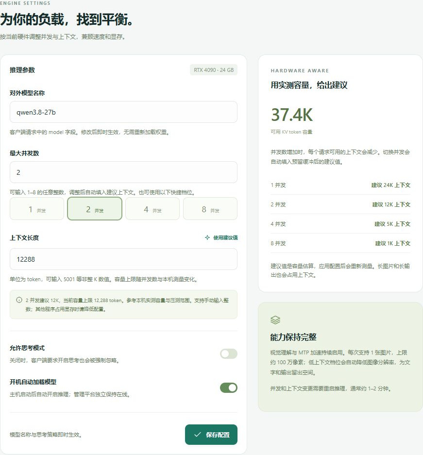
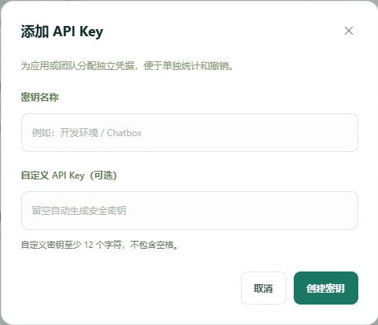

# mavi-vllm 管理平台

mavi-vllm 是部署在 Ubuntu 上的 vLLM 管理平台。管理员可以在浏览器里启停模型、调整显存相关参数、验证文本与图片推理，并为不同客户端分配 API Key。客户端通过 OpenAI 兼容接口调用本机模型。


截图来自已有部署。模型名称、接口地址和统计数据以实际运行界面为准。

## 功能与界面

| 功能 | 可以做什么 |
| --- | --- |
| 运行概览 | 启动、停止或重启模型。停止推理可释放模型占用的 GPU 显存，管理网页继续在线。 |
| 推理配置 | 设置对外模型名、并发数、上下文长度、思考策略和开机加载。调整并发后，页面会根据机器容量填入建议上下文。 |
| 在线调试 | 直接发送文本或单张图片，查看流式回复和 token 用量。部署的模型支持视觉理解与 MTP。 |
| API 访问 | 创建多个独立 API Key，按客户端查看调用次数、停用或撤销访问。 |
| 监控与账户 | 查看请求量、成功率、吞吐、延迟和运行日志，导出 CSV，修改管理密码。 |

### 推理配置

选择快捷档位或手动输入 1–8 的整数并发数，再按页面给出的容量上限设置上下文。运行中修改并发或上下文会重新加载模型。



### 在线调试

模型就绪后可以直接发送问题，或添加一张图片并说明要识别的内容。


### API Key 管理

为每个客户端创建独立密钥。自定义值留空时，平台会生成密钥。



## 访问与调用

| 用途 | 地址 |
| --- | --- |
| 局域网管理网页 | `http://<Ubuntu-IP>:20204/` |
| Ubuntu 本机管理网页 | `http://127.0.0.1:20204/` |
| OpenAI 兼容 API Base URL | `http://<Ubuntu-IP>/v1` |

将 `<Ubuntu-IP>` 替换为服务器当前地址。登录后，从「API 访问」复制 Base URL 和已启用的 API Key，并使用「运行概览」显示的模型名。本仓库的部署配置默认使用 `liuxing`，截图展示的是早期部署的模型别名。

下面的示例假定当前终端已设置 `MAVI_API_KEY`。如果界面上的模型名称不同，请替换请求中的 `model`。

```bash
MAVI_BASE_URL='http://<Ubuntu-IP>/v1'

curl "$MAVI_BASE_URL/chat/completions" \
  -H "Authorization: Bearer $MAVI_API_KEY" \
  -H 'Content-Type: application/json' \
  --data '{"model":"liuxing","messages":[{"role":"user","content":"你好，请介绍一下你自己。"}]}'
```

使用 HTTP 的部署应限制在可信网络内。首次登录后，可在「账户安全」更新管理密码。

## 部署与运维

管理服务和 API 网关使用同一个 C++20 可执行文件，以独立的 systemd 服务运行。模型由 vLLM 的 Python 环境加载。部署脚本面向已准备好 NVIDIA 驱动、vLLM、兼容的 GGUF 加载组件、模型权重和 systemd 推理服务的 Ubuntu 主机。

### 构建与隔离测试

```bash
sudo apt install build-essential cmake libboost-dev libssl-dev libsqlite3-dev nlohmann-json3-dev
cmake -S . -B build -DCMAKE_BUILD_TYPE=Release
cmake --build build --parallel 2
ctest --test-dir build --output-on-failure
```

后台测试用 Python 3 启动本地 C++ 进程和模拟推理服务。安装 `python3-cryptography` 可额外验证与旧版 SQLite 密钥的双向兼容。测试在临时目录运行。

### 安装或升级

核对脚本中的用户、目录和服务名。升级前备份三个服务单元和现有 `data/platform.sqlite3`、`data/secret.key`。在目标主机的应用目录执行 `sudo bash scripts/install-system.sh`，脚本构建并安装二进制，然后切换服务入口。既有数据库及密钥格式可以直接沿用。升级会短暂中断请求，并按升级前状态决定是否重新启动模型。

- [运维说明](OPERATIONS.txt)记录模型文件、服务路径、配置范围和验证方式。
- [systemd 部署脚本](scripts/install-system.sh)配置管理网页、API 网关和推理服务。
- [`backend/`](backend/)包含管理 API、推理网关和模型启动器，[`static/`](static/)包含网页界面。
- [`tests/`](tests/)包含前端交互、后端逻辑和模型集成测试。已安装开发依赖时可运行 `npm run test:ui`。
